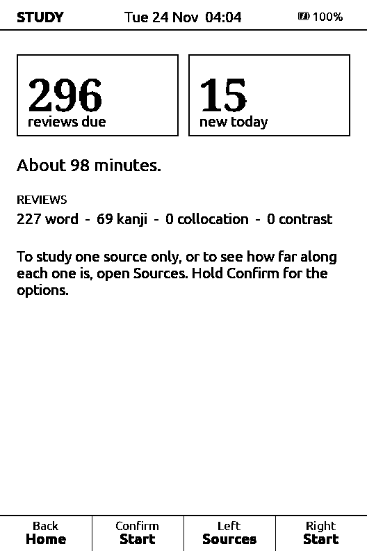
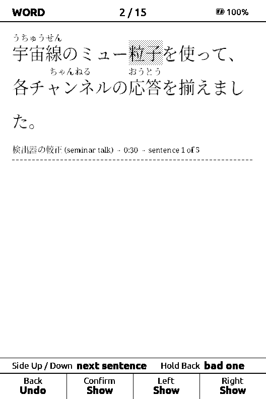
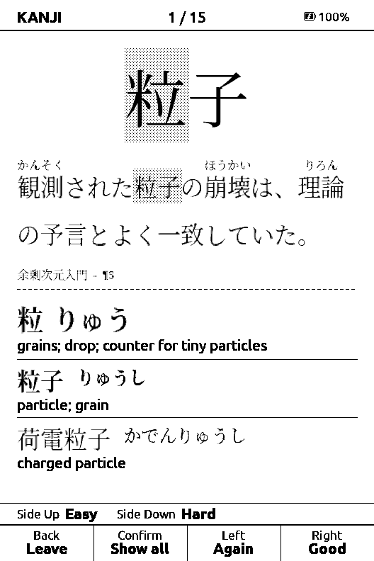
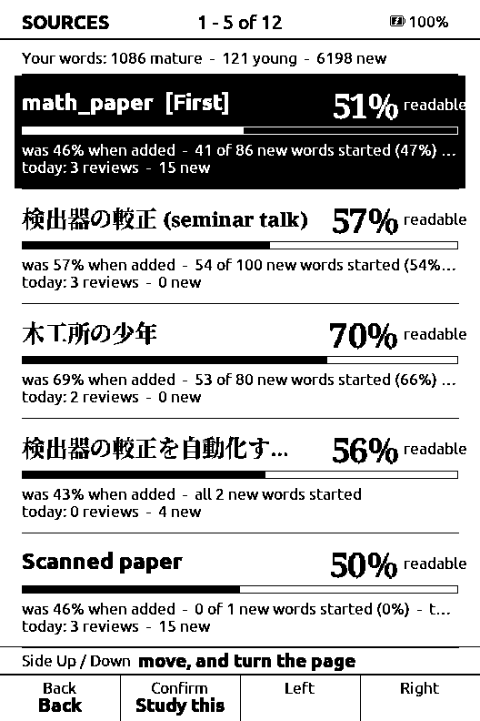

# Sumitsubo Reader

Sumitsubo Reader is [Matcha Reader](https://github.com/eszter007/matcha-reader) with a **Study** mode.
It reviews flashcards made from your own Japanese material (papers, books, talks, videos) and lets
the reader use what you know: how much of a book you can read today, which words are new, which
furigana you no longer need.

The cards are made on a computer by the [Sumitsubo desktop program](https://github.com/OWNER/sumitsubo).
The device schedules and shows them; a sync carries reviews one way and the deck the other.

<p align="center">
  
  
  
  
</p>

> **Status: early.** Everything here runs in the desktop simulator, as an Xteink X3. It has not yet
> run on a device. Expect rough edges, and please report what you find.

Everything in Matcha Reader is still here and works as before: vertical Japanese text, word
lookup, sentence mining, manga, reading insights. See Matcha's [User Guide](USER_GUIDE.md).

## What Sumitsubo adds

**Study, a new entry on the Home screen**

- Word, kanji, collocation and contrast cards, each shown in a sentence from your own sources.
- Scheduling on the device with FSRS, the same model the desktop program uses. No computer or
  network is needed to review.
- Four answers on the four front buttons (Right is Good, as a page is turned forward), or by tilting.
- Study everything due, or one source at a time. Each source shows how readable it is today.
- Hold Back to throw out a bad sentence; the card carries on with another one.
- The tested word marked with a grey ground, a box or an underline, and smoothed text, both optional.

**A reader that knows your cards**

- "Readable: 86%" for the open book, following your reviews.
- New words marked on the page, and furigana left off the words you know well (both optional).
- Words you save in word lookup become cards at the next sync; a word that already has a card
  shows "In Study" instead.

How to use all of it: **[docs/study.md](docs/study.md)**.

## Getting started

You need the device (or the simulator), an SD card, and the desktop program.

1. **Install the desktop program** and add a source or two. See its
   [README](https://github.com/OWNER/sumitsubo#readme).
2. **Build and flash this firmware.** There are no pre-built files yet.

   ```bash
   git clone --recursive https://github.com/OWNER/sumitsubo-reader.git
   cd sumitsubo-reader
   pio run              # build
   pio run -t upload    # flash, with the device connected by USB-C
   ```

   This is Matcha's build, unchanged: [docs/building.md](docs/building.md) has the details and
   the other boards. To try it with no device, see [the simulator](docs/study.md#trying-it-without-a-device).
3. **Prepare the card once.** With the SD card in a card reader:

   ```bash
   sumitsubo card-setup /path/to/card
   ```

   This downloads Matcha's Japanese dictionary and fonts (225 MB) and writes your deck.
4. **Sync whenever you like**, with the card in a card reader or over Wi-Fi with the device on
   File Transfer:

   ```bash
   sumitsubo sync /path/to/card
   sumitsubo sync http://sumitsubo.local
   ```

   The desktop program's Reader page has the same thing as a button.

Then open **Study** on the device.

## How it works with the desktop program

| | Desktop program | Reader |
| --- | --- | --- |
| Reads your sources and makes cards | yes | |
| Decides which words and kanji are worth a card | yes | |
| Shows cards and schedules reviews | | yes |
| Keeps the review history | takes it in at each sync | writes it |
| Books | sends the ones you mark | reads them |

A sync takes in your reviews, the sentences you marked bad and the words you saved while reading,
then sends a fresh deck. Neither side needs the other switched on in between: the device has
everything it needs for weeks of reviews.

## Relation to Matcha Reader

This is a fork of [Matcha Reader](https://github.com/eszter007/matcha-reader) by Eszter Schuffert,
itself a fork of [CrossPoint](https://github.com/crosspoint-reader/crosspoint-reader). The reader,
the dictionary, the fonts and nearly all of the code are theirs. Sumitsubo's additions are small
and kept apart: `lib/Sumitsubo`, `src/activities/sumitsubo`, and a few marked lines in Matcha's
own files. Matcha's documents ([User Guide](USER_GUIDE.md), [ROADMAP](ROADMAP.md),
[SCOPE](SCOPE.md), [GOVERNANCE](GOVERNANCE.md), most of [docs/](docs/)) are kept as they are and
describe Matcha.

Two things differ on purpose:

- **Name and artwork.** Matcha's cat is its author's own artwork and is not part of this fork.
  The boot, sleep and end-of-book screens show an ink pot instead: a *sumitsubo*, the carpenter's
  tool for marking a straight line.
- **Updates.** The device's update check looks at this repository, not Matcha's, so that an update
  cannot replace Study with plain Matcha.

If you want the reader without Study, use Matcha Reader itself.

## Credits and licence

MIT, like Matcha Reader and CrossPoint: see [LICENSE](LICENSE). The ink pot drawing has its own
note in [assets/images/LICENSE](assets/images/LICENSE). Dictionary data, fonts and icons are
credited in Matcha's documents and keep their own licences. Scheduling follows
[FSRS](https://github.com/open-spaced-repetition/fsrs4anki).
