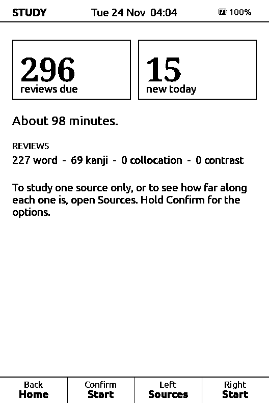
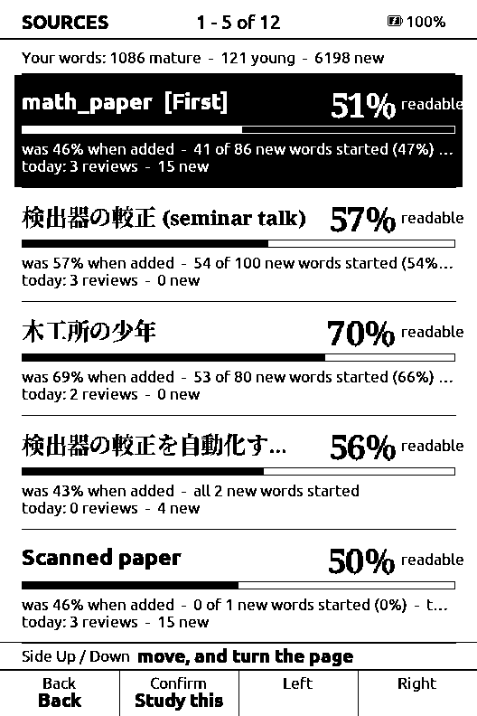
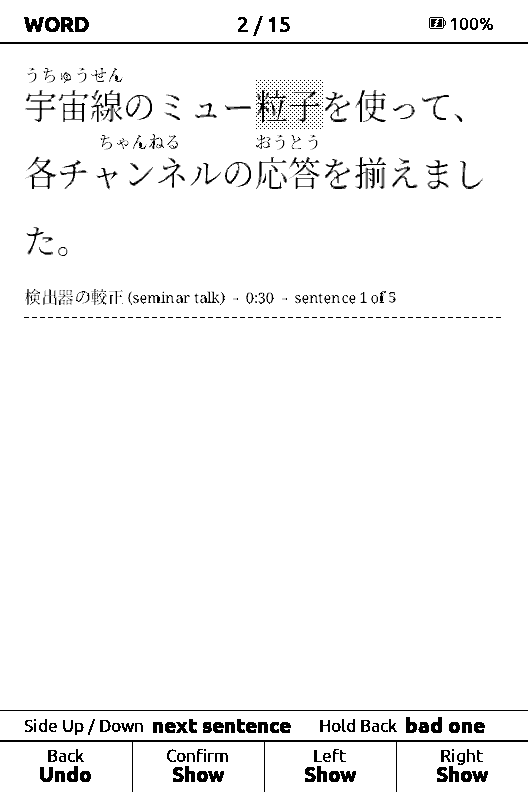
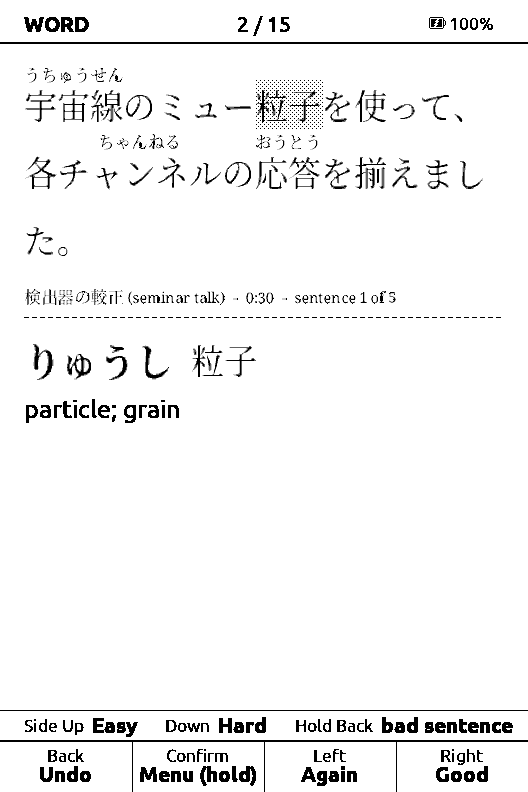
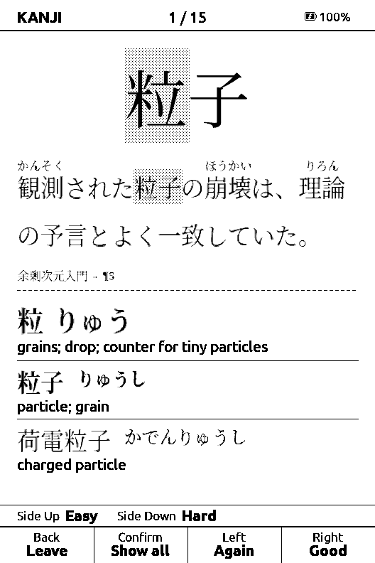
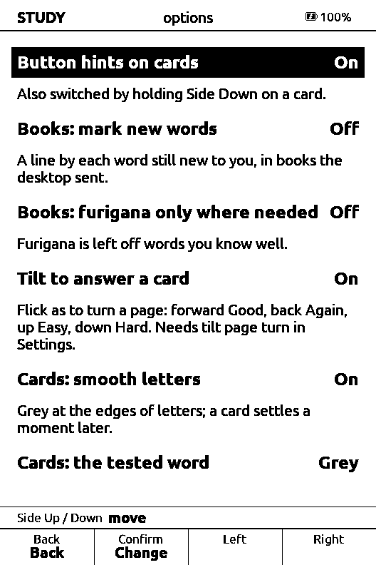

# Study

Study reviews the cards the [Sumitsubo desktop program](https://github.com/OWNER/sumitsubo) makes
from your own Japanese material. This page covers the device side: setting up, reviewing, and what
changes in the reader. Everything else about the device is in Matcha's [User Guide](../USER_GUIDE.md).

- [Setting up](#setting-up)
- [A session](#a-session)
- [Buttons](#buttons)
- [The cards](#the-cards)
- [Options](#options)
- [In the reader](#in-the-reader)
- [Syncing](#syncing)
- [Trying it without a device](#trying-it-without-a-device)
- [If something is wrong](#if-something-is-wrong)

## Setting up

1. Install the desktop program and add at least one source.
2. Flash this firmware (see the [README](../README.md#getting-started)).
3. With the SD card in a card reader, run `sumitsubo card-setup /path/to/card` once. It puts
   Matcha's Japanese dictionary and fonts on the card (225 MB) and writes your deck.
4. Put the card in the device and open **Study** on the Home screen. In the Cover Grid layout it
   is the last tab.

The first time, Study may ask you to confirm the date. Reviews are scheduled by day, and the
device only knows the date after it has been on Wi-Fi once.

## A session

<p align="center">
  
  
</p>

**Today** shows how many reviews are due and how many new cards today holds. Start from there, or
open **Sources** to see each source (how readable it is now, how many of its new words you have
started) and study one source only.

A card shows its front; you recall the answer; you show it and say how it went. A card you
answered Again comes back later in the same session, twice at most. When the queue is empty,
**Done** offers more new cards or, if you studied one source, the rest.

Leave at any time. What you did is saved after every answer.

## Buttons

| Screen | Buttons |
| --- | --- |
| Today | **Confirm** or **Right**: start. **Left**: Sources. Hold **Confirm**: Options. **Back**: Home |
| Card, front | **Confirm**, **Left** or **Right**: show the answer. **Side Up / Down**: another sentence |
| Card, answer | **Right**: Good. **Left**: Again. **Side Up**: Easy. **Side Down**: Hard. **Confirm**: all senses, when the definition did not fit |
| Card, either side | **Back**: take back the last answer, or leave when there is none to take back. Hold **Back**: bad sentence. Hold **Confirm**: card menu. Hold **Side Down**: hide or show the button hints |
| All senses | **Right** or **Side Down**: more. **Left** or **Side Up**: back to the first. **Confirm** or **Back**: the card |
| Sources | **Side Up / Down**: move. **Confirm**: study that source. **Back**: Today |
| Done | **Right**: more new cards, or carry on into the other sources. **Left**: Sources. **Confirm** or **Back**: Home |
| Options | **Side Up / Down**: move. **Confirm**: change. **Back**: Today |

Right is Good because it is the way you turn a page forward.

**Tilt.** With tilt page turn on in Matcha's Settings, a flick answers a card: the flick that
turns a page forward is Good, back is Again, up Easy, down Hard. Switch it off in Options if you
would rather not.

**Bad sentence** (hold Back). The sentence on the card is no good: cut off, misread, or just
unhelpful. The card comes straight back with its next sentence. If it has no other, it steps
aside for today, and the next sync finds it a new one or retires the card.

**Card menu** (hold Confirm): bad sentence, suspend this card, I know this well, leave Study.

## The cards

<p align="center">
  
  
  
</p>

| Card | Front | Answer |
| --- | --- | --- |
| **Word** | A sentence from your source, the word marked, furigana on the other words you have not learned | Reading and meaning |
| **Kanji** | A word that uses the kanji, shown large with the kanji marked, and a sentence | That reading of the kanji, and the words of yours that use it |
| **Collocation** | A sentence with the verb left blank | The verb that goes with that noun |
| **Contrast** | Two or three items you could mix up: look-alike kanji, same-sounding words, plain and honorific forms | Each one's reading and meaning |

A word with several sentences shows a different one each time it comes round; Side Up / Down
steps through them. The line under the sentence says which source it is from and where.

Listening cards need sound and are not shown on devices without it.

## Options

Hold Confirm on Today.

<p align="center"></p>

| Option | What it does |
| --- | --- |
| Button hints on cards | The two lines of hints at the foot of a card. Also switched by holding Side Down on a card |
| Books: mark new words | In books the desktop program sent, a thin line by each word that is still new to you |
| Books: furigana only where needed | Furigana is left off words you know well |
| Tilt to answer a card | See Tilt above |
| Cards: smooth letters | Grey at the edges of letters, as in books. Each card takes one more pass of the screen; switch it off if cards feel slow or leave traces |
| Cards: the tested word | How the word stands out in its sentence: a grey ground, a box, or a heavy underline |

## In the reader

For books the desktop program sent to the device:

- The reader menu's first line starts with **Readable: 86%**: the share of the book's words you
  can expect to read today.
- With **Books: mark new words** on, words you have not started yet have a thin line beside them
  (vertical text) or under them (horizontal text).

For any Japanese book:

- With **Books: furigana only where needed** on, furigana disappears from words you know well.
- In word lookup, a word that already has a card shows **In Study** where Save was. Any other
  word is saved as in Matcha, and becomes a card at the next sync, ahead of all other new cards.

Readable, the marks and the furigana follow the reviews you do, without waiting for a sync.
"In Study" goes by the last sync. The word lists the reader uses are compact and can be wrong
about one word in a few thousand.

## Syncing

On the computer, with the card in a card reader:

```bash
sumitsubo sync /path/to/card
```

or over Wi-Fi: open **File Transfer** on the device, join your network, then

```bash
sumitsubo sync                          # looks for http://sumitsubo.local
sumitsubo sync http://192.168.1.23      # or the address the device shows
```

The desktop program's Reader page has a Sync button that does the same.

A sync takes in your reviews, bad-sentence marks, suspensions and saved words, then sends the
deck and any books marked for the reader. Sync as often or as rarely as you like; the only cost
of waiting is that new sources and replaced sentences arrive later.

## Trying it without a device

Matcha's [simulator](https://github.com/eszter007/crosspoint-simulator-ios) builds this firmware
for a desktop window (Linux or macOS; it needs SDL2, curl and OpenSSL development files).

```bash
git clone https://github.com/eszter007/crosspoint-simulator-ios.git simulator
cd simulator
git apply /path/to/sumitsubo-reader/test/sumitsubo/simulator-tilt.patch
cmake -S ios -B build-x3 -DCROSSPOINT_FIRMWARE_ROOT=/absolute/path/to/sumitsubo-reader -DSIMULATOR_DEVICE=x3
cmake --build build-x3 -j
mkdir -p ~/sumitsubo-card && sumitsubo card-setup ~/sumitsubo-card
CROSSPOINT_SIM_SD=~/sumitsubo-card build-x3/crosspoint_simulator
```

Keys: Return is Confirm, Esc is Back, the arrow keys are Left / Right and the side buttons, P is
Power. Sync with the folder (`sumitsubo sync ~/sumitsubo-card`) or, with the simulator on File
Transfer, with `sumitsubo sync http://127.0.0.1:8080`.

## If something is wrong

- **"No deck on the card."** Run `sumitsubo card-setup` or `sumitsubo sync` with the card in the computer.
- **Kanji show as boxes.** The fonts are missing from the card: run `sumitsubo card-setup` again.
- **Everything is due at once, or nothing is.** The device's date is wrong. Join Wi-Fi once from
  File Transfer so it can set its clock, then reopen Study.
- **The large word on a kanji card looks ragged.** The desktop program found no Japanese font to
  draw it with. Install Noto Serif CJK JP on the computer and sync again.
- **Cards are slow or leave grey traces.** Switch off "Cards: smooth letters" in Options.
- **A sentence is garbage.** Hold Back on the card. The desktop program also filters these when it
  reads a source; see its README.
